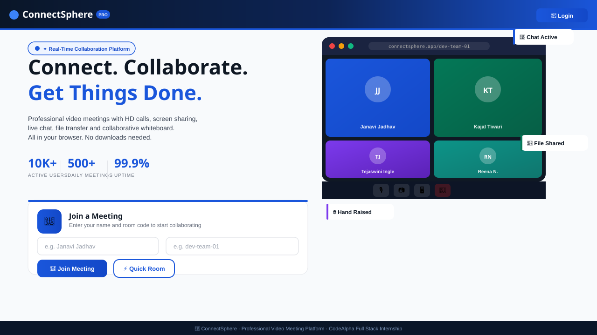
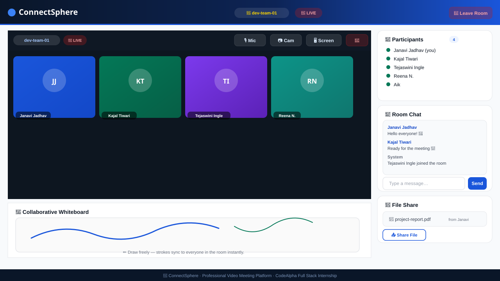
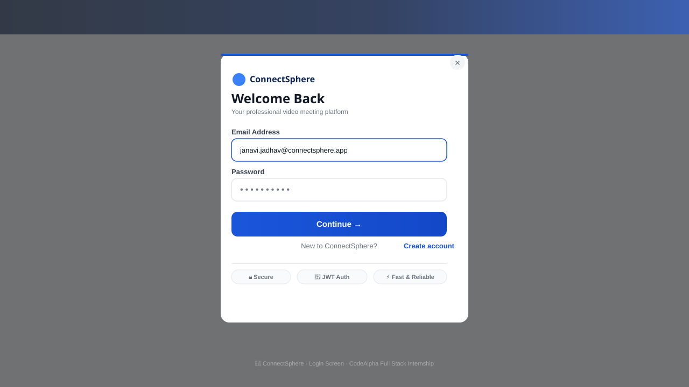
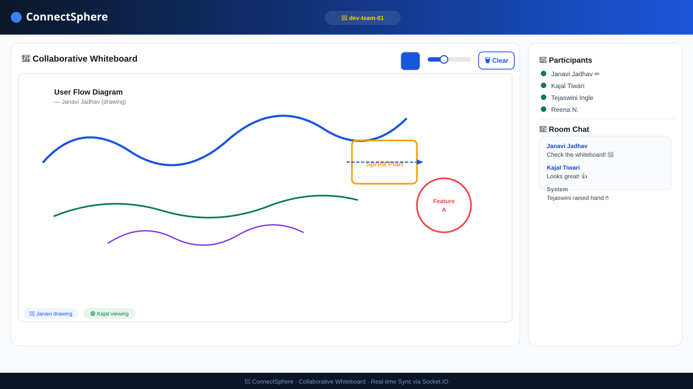

# 🔵 ConnectSphere – Real-Time Video Meeting Platform

> **CodeAlpha Full Stack Development Internship – Task 3**
> Built by **Janavi Jadhav**

A fully browser-based real-time communication platform featuring HD video calls, screen sharing, live chat, file transfer, and a collaborative whiteboard — powered by WebRTC and Socket.IO.

---

## 📸 Screenshots

### 🏠 Home Page


### 🎥 Meeting Room


### 🔑 Login Modal


### 🎨 Collaborative Whiteboard


---

## ✨ Features

| Feature | Description |
|---|---|
| 📹 **HD Video Calling** | Multi-participant peer-to-peer WebRTC video |
| 🎙️ **Audio Controls** | Toggle mic on/off during the meeting |
| 🖥️ **Screen Sharing** | Share screen or specific window instantly |
| 💬 **Real-time Chat** | Live in-room messaging with timestamps |
| 🎨 **Collaborative Whiteboard** | Shared canvas — strokes sync to all participants |
| 📎 **File Sharing** | Share files up to 2MB via Socket.IO relay |
| ✋ **Raise Hand** | Notify others you want to speak |
| 👥 **Participants Panel** | Live list of everyone in the room |
| 🔑 **Auth System** | Register / Login with JWT + bcrypt |
| ⚡ **Quick Room** | Auto-generate a room code instantly |

---

## 🛠️ Tech Stack

```
Frontend  → HTML5, CSS3, Vanilla JavaScript
Backend   → Node.js + Express.js
Real-time → Socket.IO (signaling + chat + whiteboard + files)
Video     → WebRTC (peer-to-peer media streams)
Database  → SQLite3 (user accounts, persistent)
Auth      → JSON Web Tokens (JWT) + bcrypt password hashing
```

---

## 🚀 Run Locally

```bash
# 1. Clone the repo
git clone https://github.com/janavijadhav08/CodeAlpha_RealTimeCommunication.git
cd CodeAlpha_RealTimeCommunication

# 2. Install dependencies
npm install

# 3. Setup environment
cp .env.example .env

# 4. Start the server
npm start
```

Open **http://localhost:3000** in your browser.

> ⚠️ Camera and microphone require **localhost** or **HTTPS**. HTTP on a remote IP will block media access.

---

## 📁 Project Structure

```
CodeAlpha_RealTimeCommunication/
├── public/
│   ├── index.html       ← Home page + Meeting UI (single page)
│   ├── style.css        ← All styles (professional blue theme)
│   └── app.js           ← WebRTC, Socket.IO, UI logic
├── screenshots/
│   ├── 01_home_page.svg
│   ├── 02_meeting_room.svg
│   ├── 03_login_modal.svg
│   └── 04_whiteboard.svg
├── server.js            ← Express + Socket.IO + Auth APIs
├── .env.example         ← Environment variable template
├── package.json
└── README.md
```

---

## 🔐 Environment Variables

Create a `.env` file based on `.env.example`:

```env
PORT=3000
JWT_SECRET=your-super-secret-key-change-this
```

---

## 🌐 How It Works

```
Browser A ──────────────────────── Browser B
    │                                    │
    │◄──── Socket.IO (Signaling) ───────►│
    │       (offer / answer / ICE)        │
    │                                    │
    │◄════════ WebRTC P2P Stream ════════►│
              (Video + Audio direct)

Chat / Whiteboard / Files → via Socket.IO server relay
```

---

## ⚠️ Notes

- Change `JWT_SECRET` before any deployment
- Use **HTTPS** in production (required for WebRTC camera access)
- SQLite DB is auto-created on first run (`meetings.db`)
- This is an **educational MVP** — add rate limiting, email verification, and security hardening before production use

---

## 👩‍💻 Author

**Janavi Jadhav**
CodeAlpha Full Stack Development Intern

[](https://github.com/janavijadhav08)
